<p align="center">
  
</p>

<p align="center">
  
</p>

<p align="center">
  
  
  
  
</p>

## Overview

A NestJS exam project implementing a vehicle-management API. It uses TypeORM persistence, DTO validation, static serving and a WebSocket gateway, organised in the standard Nest module structure.

## Highlights

- Vehicle CRUD endpoints
- DTO validation with class-validator
- TypeORM persistence
- WebSocket gateway and static serving
- Unit and e2e tests

## Tech stack

<p align="center">
  
</p>

## Getting started

**Prerequisites:** Node.js 20+ and MongoDB.

```bash
npm install
npm run start:dev
```

---

<p align="center">
  
</p>

<p align="center">
  Built by <a href="https://github.com/Skander-Bardaoui"><b>Skander Bardaoui</b></a> ·
  <a href="https://skander-bardaoui.netlify.app/">Portfolio</a> ·
  <a href="https://github.com/Skander-Bardaoui?tab=repositories">All repositories</a>
</p>
